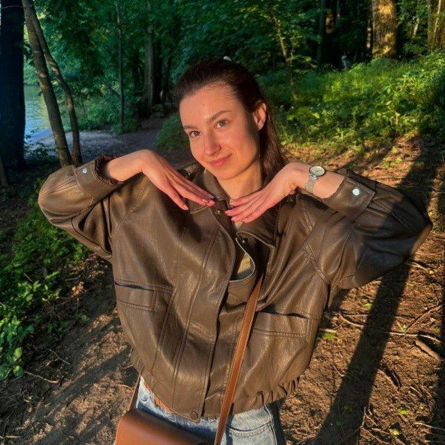

# Polina Soroko


## My contacts
*phone number:* +375(29)373-14-66\
*my email:* ssspolllinnaa0703w@gmail.com, sorokpoli54@gmail.com\
*discord:* @polina034740\
*gitHub:* @polinasoroko
## About me
My priorities are to become **a good specialist in the sphere of IT**. 
>I like learning and apreciate, when people strive for knowledge.

`I completed my basic education with a special certificate and graduated from school with a gold medal.`\
Now I am a student `at the Faculty of Engineering and Economics at the Belarusian State University of Informatics and Radioelectronics`. I'm studying for a degree in `Information Systems and Technoloqies in Economics.`
## Skills
* C/C++
* Python
* HTML, CSS
* IDEF0, BPMN, UML
* Databases
## Languages
**German B1-B2**, `a successfully participated in the Republican German language Olympiad 2022/2023 and 2023/2024`\
**English B2**
## Code
[oop-2-sem-LW-9.Exeptions](https://github.com/PolinaSoroko/oop-2-sem-LW-9.Exeptions.git)
```C++
int main() {
    setlocale(LC_ALL, "RUS");
    SetConsoleOutputCP(1251);
    SetConsoleCP(1251);
    set_terminate(myTerminateHandler);

    try {
        int* testMemory = new int[10000000000];
        delete[] testMemory;
    }
    catch (const bad_alloc& e) {
        cerr << "Исключение при выделении памяти через new: " << e.what() << endl;
    }

    try {
        cout << "\n=== Демонстрация исключения при создании Jewelry ===\n";
        Jewelry brokenJewel("Браслет", 5000, "Золото", -15);
    }
    catch (const exception& e) {
        cerr << "Исключение в конструкторе Jewelry: " << e.what() << endl;
    }

    while (true) {
        try {
            Order order;
            order.inputOrder();
            order.displayOrder();
        }
        catch (const exception& e) {
            cerr << "Не удалось оформить заказ: " << e.what() << endl;
        }

        string choice;
        cout << "\nХотите оформить еще один заказ? (да/нет): ";
        getline(cin, choice);
        if (choice != "да" && choice != "Да") {
            cout << "Выход из программы.\n";
            break;
        }
    }

    return 0;
}
```
## Links
[2 sem OAIP kursach](https://github.com/PolinaSoroko/oaip-2-sem-kursach.git)\
[CV Rolling-scopes-school](https://github.com/PolinaSoroko/rsschool-cv.git)\
[3 sem OOPiP kursach](https://github.com/PolinaSoroko/kursach_oopip_3sem.git)


